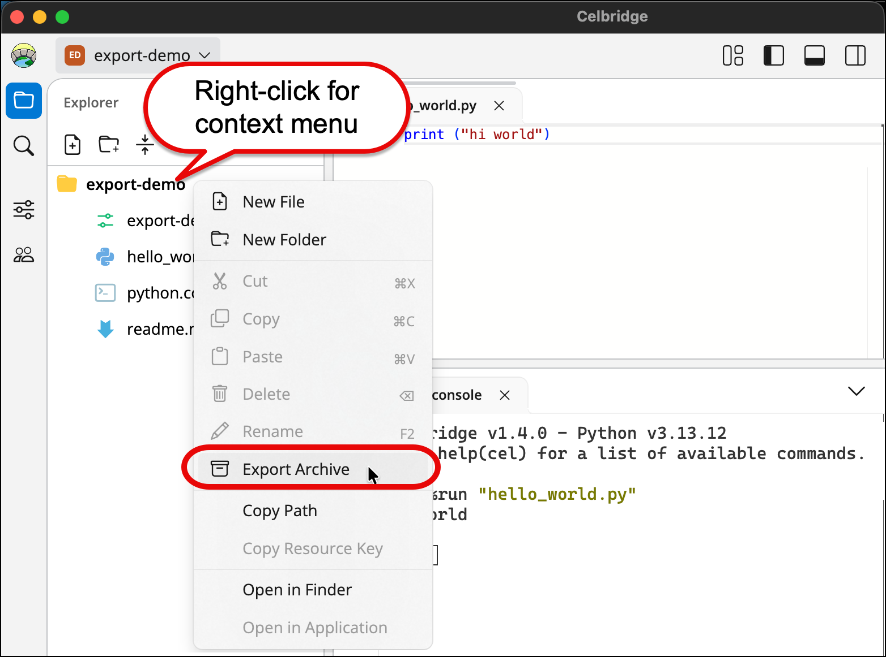

# Export whole project to ZIP archive

It's very easy to export a complete Celbridge project as a ZIP archive.

Use the **Export Archive** option on the context menu for the main project folder in the Explorer panel.

## Steps to export project as archive

1. Ensure the **Explorer Panel** is showing the project files and folders.

2. Display the context menu (Right-mouse click) for the project folder (it's awlays the first folder).

3. From the popup content menu choose **Export Archive**.

    { width="50%" }

4. You'll be offered a dialog for where to store the archive ZIP file 

